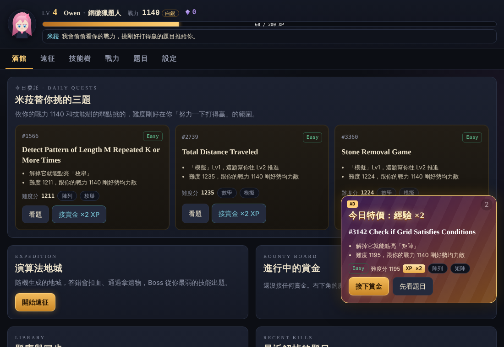
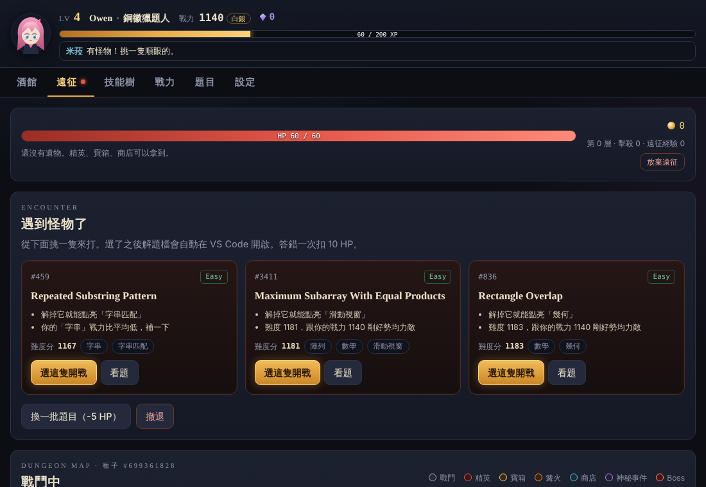
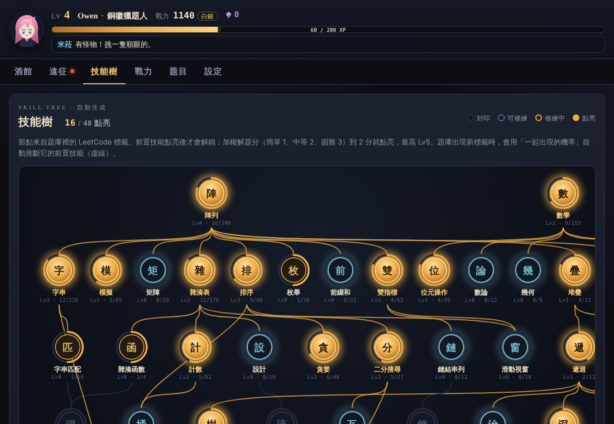
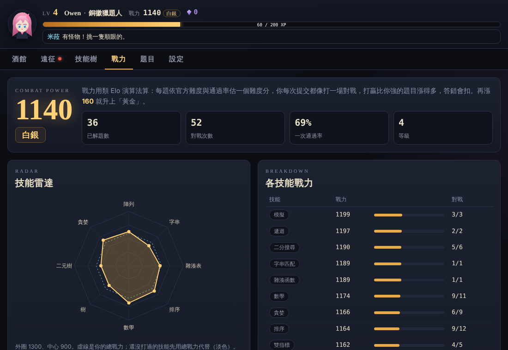
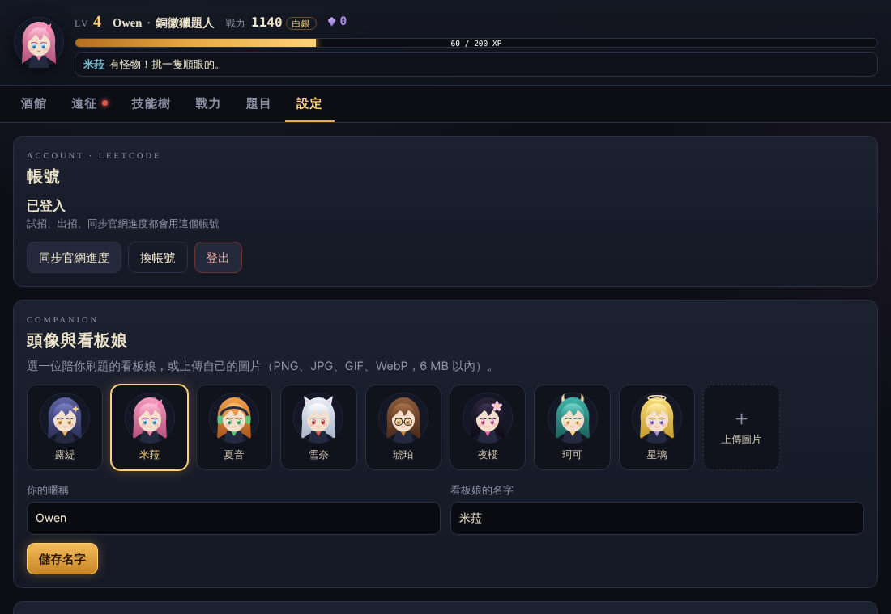

# LeetCode 演算法地城

**把刷 LeetCode 變成一款肉鴿（Roguelike）遊戲。** 解題會點亮技能樹、累積戰力，選題後解題檔會直接在 VS Code 打開，看題、試跑、提交都在遊戲裡完成，還有看板娘陪你一起刷題。

*A roguelike game layer for LeetCode: auto-generated skill tree, Elo-style power rating, smart problem recommendations, and a VS Code workflow. Traditional Chinese UI.*



## 特色

- **肉鴿遠征**：每局隨機生成 10 層地城，有戰鬥、精英、寶箱、篝火、商店、神秘事件和 Boss。答錯扣血、通過拿遺物，Boss 會從你最弱的技能出題。死掉會留下結晶，可以買永久強化。
- **自動技能樹**：依題目的 LeetCode 標籤自動長出來。題庫出現新標籤時，演算法會自己推斷它的前置技能。
- **戰力分析**：用類 Elo 算出總戰力、段位和各技能戰力，並畫成雷達圖。
- **推薦廣告**：挑「努力一下打得贏」的題目，用廣告推給你，接下就是雙倍經驗的賞金任務。
- **VS Code 整合**：選題就自動開檔，游標停在要寫程式的地方，按 `Ctrl+Shift+B` 直接提交。
- **每個人都能玩**：在遊戲裡登入自己的 LeetCode 帳號、換看板娘或上傳頭像、換背景，也能選解題語言（Python、C++、Java、JavaScript、Go、Rust…）。

| 遠征 | 技能樹 |
|---|---|
|  |  |
| **戰力** | **看板娘** |
|  |  |

## 快速開始

### 方法 A：下載 EXE（Windows，不用裝 Python）

1. 到 [Releases](../../releases) 下載最新的 `LeetCodeDungeon.exe`。
2. 雙擊執行，瀏覽器會自動打開遊戲畫面。
   > Windows 第一次可能跳出「Windows 已保護您的電腦」，因為這個 EXE 沒有付費簽章。按「其他資訊 → 仍要執行」即可。程式完全開源，可以自己從原始碼打包。
3. 跟著新手引導選看板娘、選語言、登入 LeetCode。

你的資料會存在 `文件\LeetCodeDungeon`。

### 方法 B：從原始碼執行（任何作業系統）

```bash
git clone https://github.com/OwenWu930302/happy-leetcode-dungeon.git
cd happy-leetcode-dungeon
pip install -r requirements.txt
python lc.py game
```

需要 Python 3.8 以上。你的資料會存在專案底下的 `workspace/`（已被 `.gitignore` 排除，不會被上傳）。

## 登入 LeetCode

試跑、提交、同步官網進度都需要登入。遊戲**不需要你的密碼**。

**方法一：用瀏覽器登入（推薦）**
到「設定 → 帳號」按「用瀏覽器登入 LeetCode」。程式會用你電腦上的 Edge 或 Chrome 開一個獨立的登入視窗，你在裡面正常登入（email、GitHub、Google 都可以），完成後視窗會自動關閉。

- 密碼是直接輸入給 LeetCode 官網，遊戲完全碰不到。
- 登入視窗使用獨立的瀏覽器設定檔（存在工作區的 `browser-profile/`），不會動到你平常的瀏覽器。
- cookie 過期時再按一次，通常 LeetCode 還記得你，不用重打密碼。
- 原理：LeetCode 沒有給第三方用的官方登入，所以程式透過瀏覽器內建的除錯介面（只聽本機 127.0.0.1）讀取 `leetcode.com` 的兩個 cookie。程式碼在 [`game/browser_login.py`](game/browser_login.py)。

**方法二：手動貼 cookie（備案）**

1. 用瀏覽器登入 [leetcode.com](https://leetcode.com)。
2. 按 `F12` → **Application（應用程式）** → 左邊 **Cookies** → `https://leetcode.com`。
3. 複製 `LEETCODE_SESSION` 和 `csrftoken` 的 Value，貼到「設定 → 帳號 → 備案：手動貼 cookie」，按「驗證並登入」。

不管用哪個方法，cookie 都只存在你電腦上工作區的 `config.json`，不會上傳到任何地方。

## 在 VS Code 邊寫邊玩

1. 到遊戲的「設定 → 工作區」按「安裝 VS Code 任務」（順便會開啟自動存檔），再按「在 VS Code 開啟工作區」。
2. VS Code 會問「允許自動任務？」，選允許，之後一打開工作區遊戲就會自動啟動。
3. 按 `Ctrl+Shift+P` → 輸入 **Simple Browser: Show** → 貼上 `http://localhost:8765`，把遊戲拖到編輯器右邊。
4. 在遊戲裡選題，解題檔會自動打開。寫完在遊戲按「試招」（不扣血）或「出招」（正式提交），或在 VS Code 按 **`Ctrl+Shift+B`** 直接提交。

不管從哪裡提交，遊戲都會自動判定戰果。

## 玩法

| 畫面 | 內容 |
|------|------|
| **酒館** | 今日委託（依戰力挑的 3 題）、賞金任務、同步官網進度、擴充題庫 |
| **遠征** | 選路線、打怪、拿遺物。戰鬥從 2~3 題裡挑一題打，答錯一次扣 10 HP（精英 16、Boss 22） |
| **技能樹** | 加權解題分（簡單 1、中等 2、困難 3）達 2 分就點亮，最高 Lv5；前置技能點亮後才解鎖下一環 |
| **戰力** | 總戰力、段位（青銅 → 傳說）、技能雷達、各技能戰力 |
| **題目** | 題目敘述、自訂測資、試招、出招、判題結果 |
| **設定** | LeetCode 帳號、看板娘與頭像、背景、解題語言、工作區 |

遺物共 12 種，例如「小黃鴨」讓每場戰鬥第一次答錯不扣血，「招財貓」可以免費換題。永久強化可以用結晶購買，例如最大 HP、遠征經驗加成、開場遺物。

題庫預設只有簡單題（內建 947 題，不用等下載）。到酒館按「擴充題庫」可以抓全部難度，技能樹會長出動態規劃、圖論等更深的分支。

## 背後的演算法

都在 [`game/engine.py`](game/engine.py) 和 [`game/rogue.py`](game/rogue.py)。

- **技能樹自動生成**：每個 LeetCode 標籤是一個節點。常見標籤使用手寫的前置關係；沒看過的標籤則找「比它常見、又最常一起出現」的標籤當前置。邊只從常見指向罕見，所以保證不會有環。接著用 **Kahn 拓撲排序** 算層數、**重心法** 排版減少連線交叉，再依拓撲序做一次 **DAG DP**，決定每個節點有沒有點亮。
- **戰力**：每題依官方難度與通過率估一個難度分，把每次提交當成一場對戰，用 **Elo** 逐筆更新。各技能戰力等於總戰力加上你在該技能的「超額表現」，樣本少時會打折。
- **推薦**：每題分數 =「難度離你的戰力 +80 多近」（高斯分布）×（1 + 技能弱點加成），再依分數加權抽樣，所以每次推的題目都不一樣。
- **地城生成**：6 條路徑由下往上隨機走並避免交叉，再依層數規則分配節點種類（Slay the Spire 式）。每局都有種子，可以重現。

## 指令列工具

遊戲之外，`lc.py` 也能單獨在終端機使用。EXE 版把 `python lc.py` 換成 `LeetCodeDungeon.exe` 即可。

```bash
python lc.py game                 # 開啟遊戲
python lc.py list --undone --free # 列出還沒解的免費題
python lc.py show 1               # 看題目
python lc.py new 1 --lang cpp     # 建立解題檔（可選語言）
python lc.py test 1               # 用範例測資試跑
python lc.py submit 1             # 正式提交
python lc.py sync                 # 同步官網進度
python lc.py fetch --all          # 抓全部難度的題庫
python lc.py random --new         # 隨機抽一題並建檔
python lc.py stats                # 看進度
python lc.py vscode               # 在工作區安裝 VS Code 任務
python lc.py push --repo <網址>   # 把工作區備份到你自己的 GitHub 倉庫
python lc.py pdf 1 9 13           # 匯出題目 PDF（需要 xhtml2pdf）
```

題號可以用數字（`1`）、slug（`two-sum`）或解題檔檔名（`0001-two-sum.cpp`）。

## 你的資料放在哪

所有個人資料都在**工作區**，每個玩家各自一份，不會進到這個開源 repo：

```
工作區/
├── config.json          登入 cookie（只在你電腦上）
├── solutions/           你的解題檔
├── data/records.json    提交紀錄
├── data/game.json       遊戲存檔（遠征、結晶、賞金）
├── data/profile.json    暱稱、看板娘、背景
└── assets/              你上傳的頭像與背景
```

- EXE 版：`文件\LeetCodeDungeon`
- 原始碼版：專案底下的 `workspace/`
- 想放別的地方：設定環境變數 `LCD_HOME`

想把解題紀錄備份到 GitHub：先開一個**你自己的**倉庫（建議 Private），然後執行 `python lc.py push --repo https://github.com/你/my-leetcode.git`。`config.json` 會被自動排除。

## 打包 EXE

**在自己電腦上**（Windows）：

```bat
build.bat
```

完成後 EXE 會在 `dist\LeetCodeDungeon.exe`。

**自動發佈**：推一個版本標籤，GitHub Actions 就會在 Windows 上打包，並發佈到 Releases。

第一次要先啟用 workflow（把範本複製到 `.github/workflows/`）：

```bat
mkdir .github\workflows
copy tools\release.yml .github\workflows\release.yml
git add .github && git commit -m "Enable release workflow" && git push
```

之後每次要發佈新版本：

```bash
git tag v1.0.0
git push origin v1.0.0
```

## 專案結構

```
lc.py                 指令列工具（抓題、建檔、試跑、提交、同步）
launcher.py           EXE 進入點
game/engine.py        演算法：技能樹、戰力、推薦
game/rogue.py         肉鴿遠征：地圖、戰鬥、遺物、強化
game/server.py        本機伺服器（只聽 127.0.0.1）
game/browser_login.py 瀏覽器一鍵登入（DevTools Protocol 讀 cookie）
game/static/          遊戲畫面（純 HTML/CSS/JS，沒有外部框架）
data/problems.json    內建題庫（簡單題）
build.bat             Windows 打包腳本
tools/release.yml     自動打包發佈的 GitHub Actions 範本
```

## 常見問題

**Q：試招或出招出現 403、同步說登入失效？**
cookie 過期了，到「設定 → 帳號」再登入一次。

**Q：出招出現 `IndentationError`，或說「還是空白範本」？**
解題檔還沒存檔（VS Code 分頁標題旁邊有白點 ●）。按 `Ctrl+S`，或在設定頁安裝 VS Code 任務來開啟自動存檔。

**Q：瀏覽器登入說找不到 Edge 或 Chrome？**
用手動貼 cookie，或設定環境變數 `LCD_BROWSER` 指向瀏覽器執行檔。

**Q：支援力扣中文站（leetcode.cn）嗎？**
目前只支援 leetcode.com 帳號。題目頁有連到力扣中文站的連結，可以對照看中文題目。歡迎 PR！

**Q：遊戲畫面開在哪個網址？**
`http://localhost:8765`（被占用時會自動往後找可用的埠，終端機會顯示）。伺服器只聽本機，其他人連不進來。

**Q：可以在 Mac / Linux 玩嗎？**
可以，用方法 B 從原始碼執行。

## 參與開發

歡迎 Issue 和 PR！一些想做的方向：力扣中文站支援、更多看板娘與遺物、成就系統、多人排行榜。

前端沒有建置步驟，改完 `game/static/` 重新整理瀏覽器就能看到；改 Python 則要重新啟動 `python lc.py game`。

## 授權

[MIT](LICENSE)。本專案與 LeetCode 官方無關。看板娘角色皆為本專案原創。
